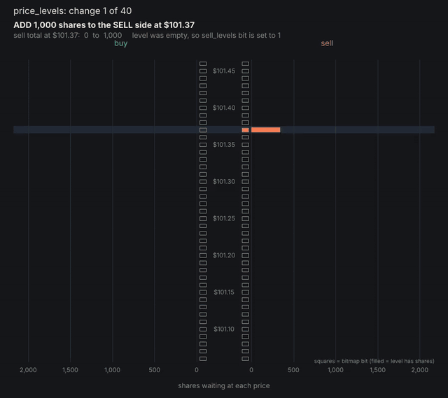
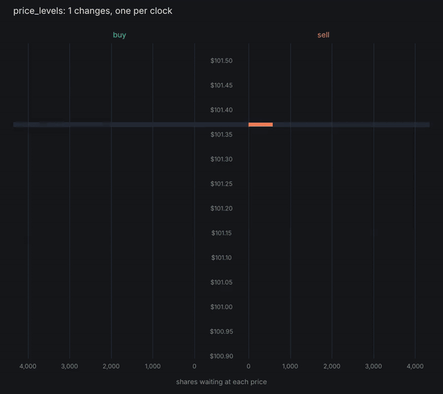
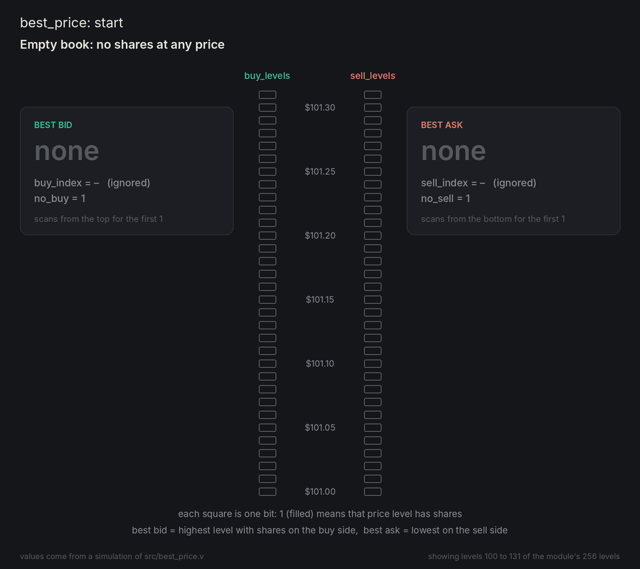

# FPGA Low-Latency Order Book (work in progress)

A hardware order book written in **Verilog**: it reads a stream of market-data messages (new orders, trades, cancels) and keeps track of the **best bid** and **best ask** for one stock, aiming for an update within a few clock cycles of each message arriving. This is the kind of system trading firms build on FPGAs, where every nanosecond counts.

The design is verified in simulation, with a self-checking testbench for every module.

> **Who wrote what:** I write all of the Verilog modules in `src/`. The testbenches in `tests/` were written by Claude (Anthropic's AI assistant), only to test my code.

---

## Progress

| Module | What it does | Status |
|---|---|---|
| `msg_rx` | Turns the incoming byte stream into message fields | ✅ **Done and tested** |
| `order_table` | Remembers every open order (side, price, shares) by order ID | ✅ **Done and tested** |
| `price_levels` | Total shares waiting at every price, for bids and asks | ✅ **Done and tested** |
| `best_price` | Finds the best bid and ask in one cycle (bitmap + priority encoder) | ✅ **Done and tested** |
| `tob_output` | Sends a top-of-book update whenever the best bid or ask changes | ✅ **Done and tested** |
| `top` | Connects everything and measures latency in clock cycles | ⏳ Next |

```
bytes ─► msg_rx ─► order_table ─► price_levels ─► best_price ─► tob_output ─► updates
```

---

## Message format

To start with, every message is a fixed **18 bytes**, modelled on NASDAQ's ITCH 5.0 feed. Numbers are big-endian, and prices have 4 implied decimals (`501000` = $50.1000). Real ITCH messages come later.

| Bytes | Field | Used by |
|---|---|---|
| 0 | Type: `A` add, `E` execute, `X` cancel, `D` delete, `U` replace | all |
| 1 – 4 | Order ID | all |
| 5 | Side: `B` buy / `S` sell | add |
| 6 – 9 | Shares | add, execute, cancel, replace |
| 10 – 13 | Price | add, replace |
| 14 – 17 | New order ID | replace |

---

## The message receiver (`src/msg_rx.v`)

Bytes arrive one per clock with a `valid` signal. A 5-bit counter tracks which byte of the message is arriving (0–17), and a `case` on the counter shifts each byte into its field: type, order ID, side, shares, price and new order ID. When byte 17 arrives, the counter resets and `msg_valid` goes high for exactly **one clock**, on the same edge that captures the last byte. The next module can use the message on the very next clock.

### Testing

[`tests/tb_msg_rx.v`](tests/tb_msg_rx.v) is a self-checking testbench (written by Claude to test my parser). It records every message it sends, compares each one the parser outputs field by field, and checks the timing of `msg_valid`.

| Test | Checks |
|---|---|
| Single add order | Every field decoded correctly |
| Every message type | Add, execute, cancel, replace and delete, back to back |
| Big-endian byte order | A different byte in every position, so offset or byte-order mistakes show up |
| Max and zero values | All-ones (`0xFFFFFFFF`) and all-zero fields |
| 200 random, back to back | One byte every clock, no gaps |
| 200 random, with gaps | Random idle cycles between bytes and between messages |
| Idle | Nothing fires while `valid` is low |

**Result: all tests pass, with 411 messages checked.**

```
PASS  single add order
PASS  every message type
PASS  big-endian byte order
PASS  max and zero values
PASS  200 random, back to back
PASS  200 random, with gaps
PASS  idle: no output while valid is low
--------------------------------------------
ALL TESTS PASSED  (411 messages checked)
```

### Run it yourself

- **In the browser (nothing to install):** paste `tests/tb_msg_rx.v` and `src/msg_rx.v` into [EDA Playground](https://www.edaplayground.com), choose **Icarus Verilog**, and click **Run**.
- **With Icarus Verilog:**
  ```bash
  iverilog -g2005 -o sim tests/tb_msg_rx.v src/msg_rx.v
  vvp sim
  ```

---

## The order table (`src/order_table.v`)

Execute, cancel, delete and replace messages only carry an order ID, not the side or price. To update the book, the hardware has to remember every open order. `order_table` stores each one in a 256-entry memory, using the low 8 bits of the order ID as the address:

```
 71        64 63                 32 31                  0
┌────────────┬─────────────────────┬─────────────────────┐
│ side (8)   │ price (32)          │ shares (32)         │   one entry, 72 bits
└────────────┴─────────────────────┴─────────────────────┘
```

An empty slot is all zeros. For each message it updates the entry and outputs one change for the next stage: *add or remove some shares, at this price, on this side*.

| Message | Table | Output |
|---|---|---|
| Add | write `{side, price, shares}` | +shares at price |
| Execute / Cancel | subtract the shares, clear the slot if none are left | −shares at the order's price |
| Delete | clear the slot | −all remaining shares |
| Replace | clear the old slot, write the new one (keeping the old side) | −old shares at old price, then **on the next clock** +new shares at new price |
| Any of these on an unknown ID | nothing | `not_found` |

A replace changes two price levels, but there is only one set of outputs, so the add is saved in `pending_data` and sent one clock later. Messages are at least 18 clocks apart, so that clock is always free.

Every output appears one clock after the message.

### Testing

[`tests/tb_order_table.v`](tests/tb_order_table.v) (written by Claude to test my module) keeps its own copy of the order table. For every message it works out which change(s) should come out, checks each output, and compares the module's memory with its copy slot by slot.

| Test | Checks |
|---|---|
| Add buy and sell | Side decoded correctly, change goes out |
| Execute partial then full | Shares go down, slot is cleared at 0, then `not_found` |
| Cancel partial then full | Same for cancels |
| Delete | All remaining shares removed, slot cleared |
| Replace keeps side, two outputs | Removal then add on the next clock; new ID works, old ID is gone |
| Replace into same ID | New order overwrites the old one correctly |
| Unknown order | Execute, cancel, delete and replace all give `not_found` |
| Max values | All-ones shares and price |
| Idle and unknown types | Nothing happens |
| 3000 random messages | Random mix of all five types, with random gaps, against the model |

**Result: all tests pass, with 3027 messages and 3481 outputs checked.** Three bugs from earlier versions were also put back one at a time (wrong fully-filled check, replace using the message's side, replace sent as an add) to make sure the testbench catches each one.

```
PASS  add buy and sell
PASS  execute partial then full
PASS  cancel partial then full
PASS  delete
PASS  replace keeps side, two outputs
PASS  replace into same ID
PASS  unknown order -> not_found
PASS  max values
PASS  idle and unknown types: no output
PASS  3000 random messages vs model
--------------------------------------------
ALL TESTS PASSED  (3027 messages, 3481 outputs checked)
```

### Run it yourself

```bash
iverilog -g2005 -o sim tests/tb_order_table.v src/order_table.v
vvp sim
```

Or paste both files into EDA Playground as above.

**Current limits:** only 256 orders at once (IDs that share their low 8 bits would collide), and the memory is read in the same clock it's written, so it won't map onto block RAM yet. A hash of the order ID and a read-then-write pipeline come later.

---

## The price levels (`src/price_levels.v`)

The order table reports each change as *add or remove some shares, at this price, on this side*. `price_levels` adds those changes up into a running total of shares waiting at every price, separately for buys and sells.

It covers a window of **256 prices, one cent apart, starting at `BASE_PRICE`** (set to $100.00, so $100.00 to $102.55). A price is turned into a level number with:

```
level = (price - BASE_PRICE) / TICK        TICK = 100  (one cent, with 4 implied decimals)
```

Two things are kept for each side:

- **Totals:** `buy_qty_map[0:255]` and `sell_qty_map[0:255]`, one 32-bit total per level.
- **Bitmaps:** `buy_levels[255:0]` and `sell_levels[255:0]` (outputs), one bit per level. A bit is 1 while that level has shares and goes back to 0 when its total reaches zero. The next module only has to look at these bits to find the best bid and ask.

| Input | Meaning |
|---|---|
| `change_side` | 0 = buy book, 1 = sell book |
| `change_add` | 1 = add shares, 0 = remove shares |

Two flags last exactly one clock: `out_of_range` (the price is outside the window, so the change is ignored) and `error` (removing more shares than the level holds, so the change is ignored). Everything else updates one clock after the change, and changes can arrive on consecutive clocks, which is what a replace sends.

### Testing

[`tests/tb_price_levels.v`](tests/tb_price_levels.v) (written by Claude to test my module) keeps its own total for every level on both sides. After every clock it checks all 256 totals and all 512 bitmap bits against its copy.

| Test | Checks |
|---|---|
| Starts empty | Nothing set before any change |
| Single add, bid and ask | Totals and bits for one buy and one sell |
| Accumulate, partial remove, full remove | Totals add up, bit stays set until the level is empty |
| First and last level | The edges of the window, both sides |
| Bid and ask at the same price | The two sides do not affect each other |
| Back-to-back changes | Remove then add on consecutive clocks, including the same level |
| Max quantity | All-ones (`0xFFFFFFFF`) shares |
| `change_valid` low | Inputs are ignored |
| 5000 random changes | Random adds, cancels and executions against the model, with 0 to 2 idle clocks between them |
| Drain the book | Remove everything, both bitmaps end at zero |
| Out of range prices | Just below and above the window, far above, price 0: flagged and nothing changes |
| Remove more than held | `error` is set and nothing changes |

**Result: all tests pass, with 5478 changes and 8909 full-state checks.** Five deliberately broken versions of the module (the bitmap using the old total, sells reading the buy totals, removals ignored, `change_valid` ignored, and a bit that never clears) were also run to make sure the testbench catches each one.

```
  ok   starts empty
  ok   single add, bid and ask
  ok   accumulate, partial remove, full remove
  ok   first and last level
  ok   bid and ask at same price are independent
  ok   back-to-back changes
  ok   max quantity
  ok   ignores inputs while change_valid is low
  ok   5000 random changes vs model
  ok   drain book to empty
  ok   out of range prices rejected
  ok   remove more than held sets error
-----
5478 changes, 8909 full-state checks, 0 errors
ALL TESTS PASSED
```

### Run it yourself

```bash
iverilog -g2005 -o sim tests/tb_price_levels.v src/price_levels.v
vvp sim
```

Or paste both files into EDA Playground as above.

### Watching it work

These two animations replay changes through the module and draw the totals it holds (the bars) and its bitmap bits. The numbers are read from a simulation of `price_levels`.

**Slow, with a caption for each change** (40 changes, one every 1.5 seconds). The caption says what was added or removed, the total before and after, and when a bitmap bit is set or cleared. [Full quality video](docs/ladder_slow.mp4).



**Fast, no captions** (500 changes at 30 changes per second). The module accepts a change on every clock cycle, so in hardware it would run far faster than this. [Full quality video](docs/ladder_fast.mp4).



**Current limits:** the window is fixed (it does not re-centre as the market moves), and the share totals are not an output yet. Both are for later.

---

## The best price finder (`src/best_price.v`)

`price_levels` keeps one bit per price level: 1 while that level has shares. `best_price` reads those two bitmaps and picks the **best bid** and the **best ask**. The module inside the file is called `best`.

- **Best bid** (`buy_index`): the **highest** price level with shares. It is the highest set bit of `buy_levels`.
- **Best ask** (`sell_index`): the **lowest** price level with shares. It is the lowest set bit of `sell_levels`.
- **Empty book:** `no_buy` or `no_sell` is 1 when that side has no shares at all, and the matching index should be ignored.

The module is purely combinational (no clock), so the answer follows the bitmaps straight away and the next stage can register it. A `for` loop over all 256 levels tracks whether a set bit has already been found (`buy_change`, `sell_change`), so only the first one counts. It is written as a loop to keep it short, and synthesis turns it into a priority encoder.

| Port | Meaning |
|---|---|
| `buy_levels`, `sell_levels` | The 256-bit bitmaps from `price_levels` |
| `buy_index`, `sell_index` | Level number of the best bid and best ask |
| `no_buy`, `no_sell` | 1 when that side is empty |

### Testing

[`tests/tb_best_price.v`](tests/tb_best_price.v) (written by Claude to test my module) works out the right answer for every input with its own loop and compares. An index is only checked while its `no_*` flag is 0.

| Test | Checks |
|---|---|
| Empty book | Both flags set |
| Single level, buy only and sell only | Each side works on its own |
| First and last level | The edges of the window, both sides |
| Several levels | Best bid is the highest, best ask the lowest |
| Best level empties | The next best level takes over, flags set when a side runs out |
| Empty then non-empty | Flags go back to 0 (not stuck at 1) |
| All ones, walking one, walking zero | Every position, both sides |
| Every single buy and sell pair | 65,536 combinations |
| Random bitmaps and random single-level edits | Many densities, against the model |

**Result: all tests pass, with 72,075 input combinations checked.** Broken versions were also run to make sure the testbench catches them: best bid taking the lowest level, best ask taking the highest, skipping level 0 or level 255, the two flags swapped, a flag that gets stuck, and an early draft where the flags were never reset.

```
best testbench: 72075 input combinations checked
PASS: no errors
```

### Run it yourself

```bash
iverilog -g2005 -o sim tests/tb_best_price.v src/best_price.v
vvp sim
```

Or paste both files into EDA Playground as above.

### Watching it work

This animation replays 14 changes to the two bitmaps and shows what `best_price` reports after each one: the best bid, the best ask, and the `no_buy` / `no_sell` flags. The arrows that sweep down and up are only there to show what "the first 1 from the top (or bottom)" means. In hardware, all the levels are checked at the same time. The values are read from a simulation of `best_price`, and the picture shows 32 of the module's 256 levels. [Full quality video](docs/best_price.mp4).



---

## The top-of-book output (`src/tob_output.v`)

`best_price` gives the best bid and best ask for the current state of the book. `tob_output` watches them and pulses `best_change` for one clock whenever either one changes. The module inside the file is called `tob`.

It keeps a copy of the last best bid and best ask it saw, and the last empty/non-empty state of each side. Every clock it compares them with the inputs:

- A side going **empty**, or coming back, is a change.
- A different **index** is a change.
- Nothing is sent if the book stayed the same, and an empty book at start-up sends nothing.

| Port | Meaning |
|---|---|
| `buy_index`, `sell_index` | Best bid and best ask level from `best_price` |
| `no_buy`, `no_sell` | 1 when that side is empty |
| `best_change` | 1 for exactly one clock, one clock after a change |

### Testing

[`tests/tb_tob_output.v`](tests/tb_tob_output.v) (written by Claude to test my module) keeps its own copy of the last reported book and works out on every clock whether `best_change` should be high. It also checks that the output only changes on a clock edge. Like the real `best_price`, it never moves an index while that side is empty, so it only checks realistic inputs.

| Test | Checks |
|---|---|
| Empty book | No pulse at start-up or while it stays empty |
| Bid or ask appears | One pulse, and none while it stays the same |
| Best bid or best ask improves or worsens | One pulse for each move |
| No change | No pulse |
| Both change at once | One pulse |
| Changes on consecutive clocks | One pulse per clock |
| Change and change back | Two pulses |
| A side empties and returns | Pulse each way, including coming back at the same index |
| Both sides empty | One pulse, then none |
| Index 0 and 255 | Real prices, not "empty" |
| Every bid and every ask index | A pulse for each new index |
| Random changes, held for random lengths, and 20,000 clocks of realistic traffic | Against the model |

**Result: all tests pass, with 28,418 clocks and 10,976 changes checked.** Eight broken versions were also run to make sure the testbench catches them: pulsing on every clock, pulse not registered, one extra clock of delay, a two-clock pulse, ignoring the bid side, ignoring the ask side, ignoring empty/non-empty changes, and the wrong start-up state.

```
tob testbench: 28418 clocks checked, 10976 changes expected
PASS: no errors
```

### Run it yourself

```bash
iverilog -g2005 -o sim tests/tb_tob_output.v src/tob_output.v
vvp sim
```

Or paste both files into EDA Playground as above.

**Current limit:** it only pulses. The new best bid and ask are not sent with the pulse yet, so the next stage reads them from `best_price`.

---

## Next steps

1. **`top`:** connect everything and check the whole chain end to end.
2. Measure latency in clock cycles, then synthesize to get resource use and maximum clock speed.
3. Later: support real NASDAQ ITCH 5.0 messages, and start processing a message before it has fully arrived (cut-through) to cut latency.
